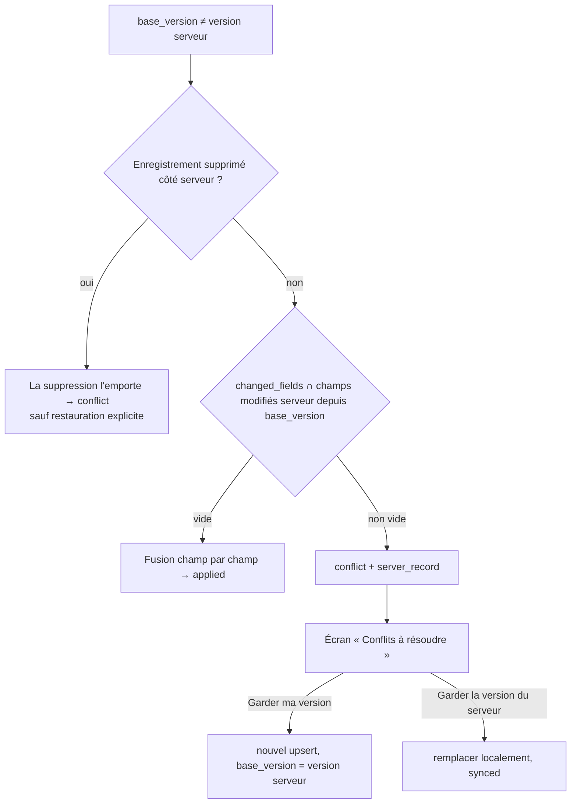

# Synchronisation KOLO

> État : **outbox et compactage implémentés côté mobile (phase 2) ; serveur
> complet — push, pull, idempotence, fusion par champ, conflits, purge —
> implémenté et testé (phase 4, §9)**. Moteur client push/pull, backoff et
> déclencheurs : phase 5 ; les sections « Phase 5 » sont le contrat à
> implémenter côté mobile. Format exact des requêtes : [API.md](API.md).

## 1. Invariants

1. Une opération validée localement n'est **jamais supprimée** à cause d'un échec
   réseau ou serveur.
2. Toute modification d'un enregistrement d'un compte produit, **dans la même
   transaction SQLite**, une entrée d'outbox.
3. Aucune résolution de conflit ne compare les horloges des téléphones : seuls
   `version` et `server_updated_at` font foi.
4. Un seul cycle de synchronisation à la fois (mutex), premier plan et tâche de
   fond confondus.
5. Le serveur applique chaque opération au plus une fois (`op_id` idempotent).

## 2. Outbox (implémenté)

Fichiers : `lib/synchronization/outbox/outbox_planner.dart` (règles pures),
`outbox_writer.dart` (écriture), `lib/synchronization/wire/payloads.dart`.

### Compactage

| Entrée en attente pour l'enregistrement | Nouvelle opération | Résultat |
|---|---|---|
| aucune | toute | ajout |
| déjà tentée (`attempts > 0`) | toute | **ajout** (l'ancienne n'est jamais modifiée) |
| upsert jamais envoyé, `base_version = 0` | delete | **annulation** : l'entrée est retirée, rien n'est envoyé ; le tombstone local reste |
| non tentée | upsert / delete | **remplacement** : contenu le plus récent, `base_version` de la plus ancienne, union des `changed_fields`, nouvel `op_id` |

Pourquoi ne jamais toucher une entrée tentée : la requête a pu atteindre le
serveur et la réponse se perdre. Si on modifiait son contenu en gardant son
`op_id`, le serveur répondrait `duplicate` et la nouvelle modification serait
perdue ; si on changeait son `op_id`, la même modification serait appliquée deux
fois.

### Format d'une entrée envoyée

```json
{
  "op_id": "9b1c…",
  "entity": "transaction",
  "entity_id": "4f0e…",
  "op_type": "upsert",
  "base_version": 3,
  "changed_fields": ["amount", "note"],
  "data": { "type": "expense", "amount": 1500, "currency": "XOF",
            "category_id": "c0a7e9e0-0000-4000-8000-000000000002",
            "note": "Zém", "occurred_on": "2026-10-09" }
}
```

`changed_fields` complète le format du §4.4 : il permet au serveur de distinguer
« le client a modifié ce champ » de « le client renvoie la valeur qu'il
connaissait ».

## 3. Cycle de synchronisation (phase 5)

```mermaid
sequenceDiagram
    participant UI as Interface
    participant DB as SQLite (Drift)
    participant SE as SyncEngine
    participant API as API Django

    UI->>DB: transaction { écrire l'opération ; outbox.record }
    DB-->>UI: streams → écran à jour
    UI->>SE: localWriteSignal (debounce 2 s)
    SE->>SE: verrou (un seul cycle)
    loop tant que l'outbox contient des entrées dues
        SE->>DB: nextBatch(≤ 100, ordre seq) ; attempts += 1 AVANT envoi
        SE->>API: POST /sync/push {device_id, operations}
        API-->>SE: results[] (applied | duplicate | conflict | rejected)
        SE->>DB: transaction { appliquer version/server_updated_at, retirer de l'outbox, statut synced/conflict/failed }
    end
    loop has_more
        SE->>API: GET /sync/pull?cursor=…&limit=500
        API-->>SE: changes + next_cursor
        SE->>DB: transaction { appliquer sauf enregistrements avec outbox en attente ; enregistrer le curseur }
    end
    SE->>DB: sync_state.last_success_at = server_time
```

- **Une seule opération par enregistrement et par lot.** Après le résultat d'une
  opération, les entrées suivantes du même enregistrement sont « rebasées »
  (`base_version` = nouvelle version) avant le lot suivant : une suite de
  modifications du même appareil ne crée jamais de faux conflit.
- **Pull** : catégories appliquées avant les transactions (clé étrangère).
- **Reprise** : outbox et curseur sont en base ; un crash au milieu d'un lot
  provoque au pire le renvoi d'opérations déjà appliquées, que le serveur
  reconnaît (`duplicate`).

## 4. Résultats du push

| Statut | Action client |
|---|---|
| `applied` | `version`, `server_updated_at` ← réponse ; `sync_status = synced` sauf si une autre entrée attend ; entrée retirée |
| `duplicate` | idem `applied` : la réponse est celle de la **première** application (même `version`), même si l'enregistrement a changé depuis |
| `conflict` | `sync_status = conflict`, version serveur conservée pour l'écran « Conflits à résoudre » ; entrée retirée |
| `rejected` | entrée `status = failed`, `last_error = code` ; enregistrement `failed`, affiché, **jamais supprimé** |

## 5. Conflits (phase 5)

Conflit potentiel quand `base_version ≠ version` serveur.



Le serveur conserve pour chaque enregistrement la version à laquelle chaque
champ a changé (`field_versions`), ce qui rend la détection exacte.

## 6. Erreurs et nouvelles tentatives (phase 5)

| Erreur | Classement | Action |
|---|---|---|
| réseau, DNS, timeout, 5xx | réessayable | backoff 5 s, 15 s, 1 min, 5 min, 15 min, puis 1 h max, avec jitter |
| 401 | session | un seul refresh concurrent, puis nouvel essai ; échec → écran de connexion **sans effacer** l'outbox |
| 400 / 422 sur une opération | définitive | `failed`, visible par l'utilisateur |
| 403 / 404 | définitive | `failed` avec message clair |

Timeouts Dio : connexion 10 s, réception 20 s. Un événement de connectivité ne
prouve rien : il déclenche seulement une tentative.

## 7. Déclencheurs (phase 5)

Ouverture et retour au premier plan · écriture locale (debounce 2 s) · retour
du réseau · « Synchroniser maintenant » et tirer-pour-rafraîchir · tâche de fond
opportuniste (WorkManager ≥ 15 min, BGTaskScheduler sur iOS). L'interface dit :
« Tes opérations seront envoyées dès que possible. »

## 8. Passage du mode local à un compte (phase 5)

À la connexion depuis le mode local : « Importer mes X opérations locales dans ce
compte ? ».

- **Oui** : dans une transaction, `user_id` ← compte pour les transactions,
  catégories personnalisées et budgets `user_id IS NULL`, `sync_status = pending`,
  une entrée d'outbox `upsert` (`base_version = 0`) par enregistrement, puis
  synchronisation.
- **Non** : les données restent dans le profil local (`user_id IS NULL`),
  invisibles depuis le compte et retrouvées en repassant en mode local.

## 9. Côté serveur (implémenté, phase 4)

Code : `backend/apps/sync/service.py` · tests : `backend/tests/test_sync_*.py`.

### Ordre et curseur

- Chaque compte a un compteur `change_seq` (`SyncCounter`). Un push verrouille
  sa ligne (`SELECT … FOR UPDATE`) pendant tout le lot : les écritures d'un
  compte sont sérialisées, donc aucun changement de `change_seq` plus petit ne
  peut devenir visible après le curseur d'un pull. Le curseur ne saute rien.
- Le lot est une seule transaction PostgreSQL, avec un point de sauvegarde par
  opération : une opération rejetée n'annule pas les autres.

### Règles d'application

| Cas | Résultat |
|---|---|
| `op_id` déjà appliqué (même compte) | `duplicate` + résultat d'origine |
| `op_id` d'un autre compte · enregistrement d'un autre compte | `rejected forbidden` |
| catégorie par défaut | `rejected read_only` |
| `upsert` d'un enregistrement inconnu | création, `version = 1` |
| `delete` d'un enregistrement inconnu | `applied`, `version = 0` (l'absence voulue est acquise) |
| `delete` d'un enregistrement déjà supprimé | `applied`, version inchangée |
| `base_version > version` | `rejected invalid_base_version` |
| `base_version = version` | l'instantané `data` est appliqué en entier |
| `base_version < version` | conflit si `changed_fields ∩ champs modifiés depuis base_version ≠ ∅`, sinon seuls les `changed_fields` sont appliqués |
| `delete` avec `base_version < version` | `conflict` (modifié ailleurs entre-temps) |
| `upsert` sur un tombstone, `base_version < version` | `conflict deleted_on_server` |
| `upsert` sur un tombstone, `base_version = version` | **restauration explicite** : le client a vu la suppression et garde sa version |
| instantané identique à l'état serveur | `applied` sans nouvelle version |

L'état **fusionné** est revalidé en entier (type et catégorie cohérents,
limites) avant écriture. Seules les opérations `applied` sont mémorisées
(`ProcessedOperation`) : un conflit ou un rejet n'a rien modifié, le réévaluer
plus tard est sans danger.

### Pull

- Ordre dans une page : catégories, budgets, opérations.
- Si une opération ou un budget de la page vise une catégorie du compte dont
  le dernier changement est **après** la page (catégorie renommée plus tard),
  cette catégorie est jointe à la page. Elle sera renvoyée à nouveau dans sa
  propre page : réappliquer une même version est sans effet.
- Le client applique un changement reçu **sauf** si l'enregistrement a une
  entrée d'outbox en attente (§3).

### Purge et curseur expiré

`manage.py purge_sync_data` (quotidien) efface les tombstones de plus de
90 jours (une catégorie archivée reste tant qu'une opération ou un budget la
référence) et les `ProcessedOperation` de plus de 90 jours. Pour chaque compte,
`purged_seq` retient le plus grand `change_seq` effacé ; un pull avec
`0 < cursor < purged_seq` répond `410 cursor_reset_required`, de même qu'un
curseur supérieur au dernier `change_seq` (serveur restauré depuis une
sauvegarde). Le client repart alors de `cursor = 0` ; son outbox renvoie ce
que le serveur ne connaît pas.

### Contrat pour la phase 5 (mobile)

- Sur `410`, effacer le curseur et refaire un pull complet. Un enregistrement
  local `synced` absent du pull complet a été purgé côté serveur : le supprimer
  localement.
- Sur `rejected duplicate_budget` (deux téléphones ont créé hors ligne le budget
  du même mois), adopter le budget du serveur au prochain pull plutôt que
  laisser l'entrée en échec.
